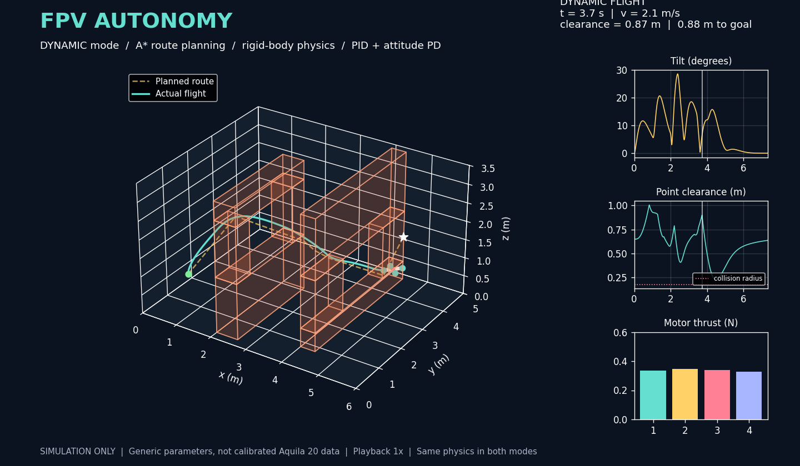

# FPV Autonomy Simulator

An educational, deterministic quadrotor simulator in Python. A simulated drone plans a 3D route around obstacles with A*, then flies it with rigid-body physics and a cascaded PID/attitude controller.



**Video:** [dynamic FPV-style flight through the 3D gates](artifacts/flight-dynamic.mp4)  
**Also included:** [static 3D route](artifacts/mission-preview.png) and [first controller plot](artifacts/controller-preview.png)

> Simulation only. The parameters are generic teaching values, not calibrated Aquila 20 data. This project has no hardware, radio, autopilot, or real-flight control interface.

## What it demonstrates

- Six-degree-of-freedom quadrotor dynamics with gravity, motor saturation, linear/angular drag, and external-force disturbances.
- X-frame motor mixing with alternating yaw torque.
- SO(3) attitude integration using the rotation exponential map.
- Position PID with anti-windup, velocity feedforward, and geometric attitude PD control.
- 26-neighbour A* on a 3D grid, with continuous segment checks against inflated obstacles.
- Greedy path simplification that only keeps checked collision-free shortcuts.
- Conservative and dynamic flight profiles. The dynamic profile is faster because the reference motion changes; the same physics and controller produce the banking.
- Collision, tracking-error, clearance, motor-limit, timeout, and timestep tests.
- Command-line metrics plus a 3D animation with tilt, tracking-error, and motor-thrust diagnostics.

A* here is classical graph search, not a trained AI model. The route is shortest on the chosen grid, not a proof of the globally shortest continuous trajectory.

## Quick start

Requires Python 3.10+ and FFmpeg for MP4 output.

```bash
python3 -m venv .venv
source .venv/bin/activate
pip install -r requirements.txt

python3 -m unittest discover -s tests -v
python3 run_mission.py --mode dynamic --scenario demo
python3 animate.py --mode dynamic --output artifacts/flight-dynamic.mp4
```

For a GIF instead of an MP4:

```bash
python3 animate.py --mode dynamic --output artifacts/flight-dynamic.gif
```

## Flight modes

Both modes use the same world, physics, controller, planner, and collision checks. Only the reference-motion profile changes.

| Mode | Behaviour | Demo result |
| --- | --- | --- |
| `conservative` | 0.25 m/s reference, stops and settles at corners | 70.49 s, 0.28 m/s peak, 1.5° peak tilt, 6.0 cm final error |
| `dynamic` | 1.85 m/s reference with velocity feedforward, keeps moving through corners | 7.34 s, 2.21 m/s peak, 28.6° peak tilt, 8.0 cm final error |

The dynamic run keeps 0.228 m minimum point clearance in a world using a 0.18 m physical clearance radius. Every integration segment is also checked against the obstacle-inflated world. A deliberately faster 2.15 m/s profile collides in the tests, so it is documented as a failure boundary rather than presented as a successful mode.

Run either scenario:

```bash
python3 run_mission.py --mode conservative --scenario demo
python3 run_mission.py --mode dynamic --scenario reverse
python3 run_mission.py --mode conservative --scenario walls
python3 run_mission.py --mode dynamic --scenario demo --json
```

Useful animation options:

```bash
python3 animate.py --mode conservative --output artifacts/flight.mp4
python3 animate.py --mode dynamic --scenario reverse --output artifacts/flight-reverse.mp4
python3 animate.py --mode dynamic --playback 1 --fps 20 --output artifacts/flight-dynamic.mp4
```

The default playback is 4x for the slow conservative run and 1x for the dynamic run. Playback speed is printed on the animation so it cannot be mistaken for simulated speed.

## Model summary

The state is position `p`, velocity `v`, rotation `R`, and body angular velocity `ω`.

Translational dynamics:

```text
m dv/dt = R e3 (T1 + T2 + T3 + T4) - m g ez - cv v + fext
```

Rotational dynamics:

```text
I dω/dt = τ - ω × (I ω) - cω ω
```

Motor thrusts are converted to total thrust and body torques through the X-frame allocation matrix, then saturated to `[0, 0.6] N` per motor. Saturation changes the applied wrench; the simulator does not pretend the requested wrench was achieved.

Attitude is advanced with:

```text
R(k+1) = R(k) exp(ω(k) dt)
```

A small SVD correction removes accumulated floating-point roundoff while keeping determinant `+1`.

The outer controller computes a bounded desired acceleration with PID terms. Its direction sets the desired thrust axis, and a geometric attitude PD loop computes body torque. The integral term freezes while acceleration or motor commands saturate.

## Planning and collision checks

1. Inflate obstacle boxes by the drone clearance radius plus the selected profile's planning buffer.
2. Search a 26-neighbour 3D lattice with deterministic A*.
3. Check every grid edge and endpoint connector as a closed segment against the expanded boxes.
4. Greedily simplify the route only when the replacement segment is also collision-free.
5. During flight, check every actual simulated position segment against the original obstacle-inflated world.

The default course keeps the two wall stations from the first preview, but rebuilds them as four-panel 3D frames: the drone climbs through a high rectangular gate, descends through a low rectangular gate, then climbs to the goal. Checked scenarios are `demo` and `reverse`; `walls` preserves the original solid-wall course for comparison.

## Repository layout

```text
fpv_sim/
  physics.py    rigid-body state, motor mixing, integration
  control.py    position PID and geometric attitude PD
  planning.py   boxes, world collision checks, A*, simplification
  mission.py    flight profiles, scenarios, closed-loop mission, metrics
run_mission.py  command-line mission runner
animate.py      verified MP4/GIF renderer
preview_control.py
preview_mission.py
tests/
```

## Limitations

- Generic 0.1 kg quadrotor parameters; not a digital twin of a real drone.
- No motor lag, battery model, propeller aerodynamics, sensor noise, state estimation, wind field, ground effect, or contact model.
- The obstacle course is synthetic and small.
- Collision checks are exact for the model's closed segments and axis-aligned inflated boxes, but they are not a real-world safety certification.
- The controller is tuned for this educational model, not safe firmware.
- The checked dynamic profile applies to the included scenarios; changing the world or profile requires rerunning the tests and clearance checks.

## Development

Run the complete suite:

```bash
python3 -m unittest discover -s tests -v
```

The suite covers hover, falling, saturation, motor torque, proper rotations, disturbance recovery, anti-windup, timestep convergence, blocked/unreachable planning, no diagonal corner cutting, both flight modes, vertical climb/descent routing, an alternate scenario, invalid inputs, timeout behaviour, and the honest too-fast failure boundary.
